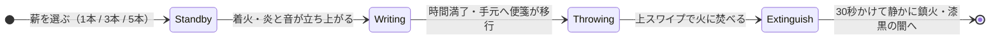

# WriteToFire

> 手放したい思考を静かに書き出し、焚き火に投げ入れて手放すセルフケア・Webアプリケーション。

**Web Site**: [https://ume-chika.github.io/WriteToFire/](https://ume-chika.github.io/WriteToFire/)  
**Repository**: [https://github.com/Ume-Chika/WriteToFire](https://github.com/Ume-Chika/WriteToFire)

---

## 儀式の流れ

タイマーや進捗バーなどの急かす要素を画面から排除し、静寂と焚き火に向き合う一方向の体験として設計されています。

---

## 設計思想と特徴

### 1. 完全ローカル完結・ゼロデータ保持（Privacy First）
入力された文章はブラウザのメモリ（JavaScript ヒープ領域）にのみ一時展開されます。  
外部サーバーへの通信はもちろん、`localStorage` や `Cookie` への書き込みも行われません。紙が燃え尽きた瞬間、またはブラウザを閉じた瞬間に一切の痕跡を残さず消滅します。

### 2. 外部アセット・外部ライブラリ不使用（Zero Dependency）
ライブラリ、外部フレームワーク、外部フォント、画像ファイル、音声ファイルの依存が一切ありません。

- **手続き型音響合成 (Procedural Audio)**: Web Audio API のピンクノイズ生成、バイカッドフィルター、オシレーターを組み合わせ、薪のはぜる音や重低音の燃焼音を数学的にリアルタイム生成。
- **軽量レンダリング**: Canvas 2D パーティクルシステムと立体的なインラインSVGのみで炎・煙・火の粉を自然に表現。
- **物理・燃焼演算**: 3D パースペクティブ変換、空気抵抗や乱流の物理シミュレーション、Canvas のくり抜き処理によるリアルタイム燃焼アニメーション。

### 3. 総容量 50〜80KB の極小設計
外部ネットワークへのサブリクエストを行わないため、初期ロードは瞬時に完了し、オフライン環境でも動作可能です。

---

## 技術スタック

| レイヤー | 技術仕様 |
| :--- | :--- |
| **Markup** | HTML5 (Semantic, Standalone) |
| **Styling** | Pure CSS3 (3D Transform, CSS Gradient, Keyframe Animations) |
| **Engine** | Vanilla JavaScript (ES6+, Web Audio API, Canvas 2D) |
| **Hosting** | GitHub Pages (HTTPS) |

---

## ライセンス

[MIT License](LICENSE) (c) 2026 Chikara Umeda
